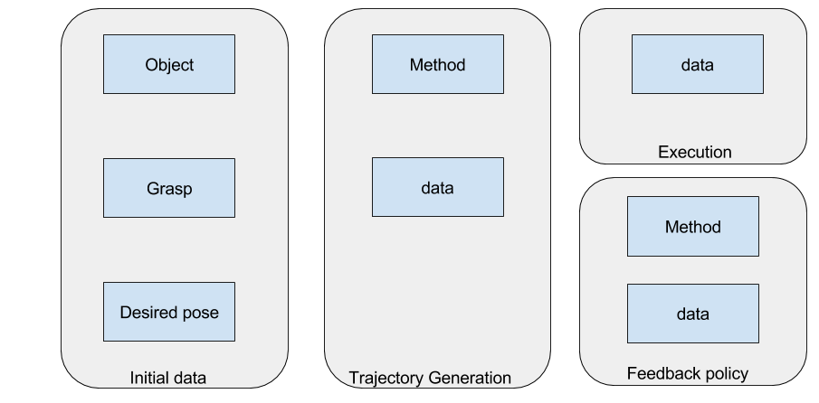

# In-Grasp Manipulation using Relaxed-Rigidity constraints
This package performs trajectory optimization to obtain joint space trajectories for moving an object to a desired pose without changing the initial grasp.
##### Folders:
- scripts: contains all the python scripts used in our method, run main_tjo_relaxed_rigid.py
- data: contains all the goal poses,weights and generated trajectories.
##### Dataset:
Currently porting to h5py.
The dataset would be in the below structure:
